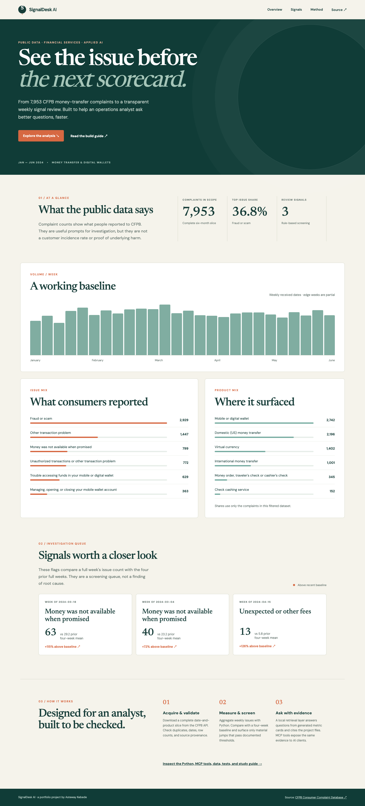

# SignalDesk AI

**An interview-ready Applied AI case study for financial-services operations.** SignalDesk turns a complete six-month slice of public CFPB money-transfer complaints into a weekly issue monitor, a grounded question-answering layer, and three MCP tools an AI client can call. [Open the interactive dashboard](https://kasteway.github.io/signaldesk-ai/web/) · [Study the build](docs/STUDY_GUIDE.md)



## The business question

An operations leader asks: **“Are any money-transfer issues rising enough to investigate, and what evidence supports that?”** Analysts often have to piece together category counts, weekly baselines, and methodological cautions. SignalDesk puts those steps in one reproducible workflow. It identifies *signals for review*, never claims a complaint spike caused harm or proves a company-specific failure.

## What is real and what is AI

- **Real data:** 7,953 public complaints received January–June 2024 for CFPB's “Money transfer, virtual currency, or money service” product. Three nonoverlapping API queries were checked against returned totals; see [`data/provenance.json`](data/provenance.json).
- **Analytics:** Python validates IDs, dates, and product; aggregates weekly issue counts; and applies an explicit four-week screening rule. The dashboard is generated from these results.
- **Retrieval:** A local TF-IDF-style term scorer searches evidence cards created from the computed data and method notes. Answers quote the local facts and give file citations. This is a deliberately small, inspectable RAG pattern—there is **no hidden model call** or invented AI outcome.
- **MCP:** A standard-I/O JSON-RPC server exposes `get_overview`, `get_signals`, and `ask_evidence` to an AI client. Tool responses include the source of the facts.
- **Privacy:** The committed data excludes complaint narratives, ZIP codes, company identifiers, and consumer information. It is public administrative data, not an internal American Express dataset.

## Try it locally

Python 3.10+; standard library only. No API key needed.

```bash
python3 -m signaldesk.core
python3 -m signaldesk.brief "What happened with fraud or scam?"
python3 -m unittest discover -s tests -v
python3 -m http.server 8000
```

Then open `http://localhost:8000/web/`. To use the MCP server, configure your client to run `python3 -m signaldesk.mcp_server` with this repo as its working directory. The server implements protocol version `2025-03-26` tool discovery and calls.

## Review the result

The leading issue in this filtered slice is **Fraud or scam**: 2,929 complaints, or 36.8% of complaints in scope. The weekly screen surfaces three issue-week combinations for review. The method, thresholds, edge-week treatment, source query, and test cases are explained in [`METHOD.md`](METHOD.md). The count is *not* a population-adjusted fraud rate.

## Where I would take it in a business setting

I would add an internal, permissioned denominator (active accounts or transactions) and validated operational metrics such as contact rate and resolution time. A human reviewer would then triage the signal, compare it with process changes and channel mix, and decide whether to escalate. That is a proposed extension, not something this public demo already does.

**Author:** Asteway Kebede · [Portfolio](https://www.astewaykebede.com/) · [LinkedIn](https://www.linkedin.com/in/kasteway/)

**Source and interpretation:** [CFPB Consumer Complaint Database](https://www.consumerfinance.gov/data-research/consumer-complaints/), [CFPB field reference](https://cfpb.github.io/api/ccdb/fields.html), [CFPB API documentation](https://cfpb.github.io/api/ccdb/api.html). CFPB notes that its complaint database is not a statistical sample, and raw complaint volume needs context such as company size and market share.
